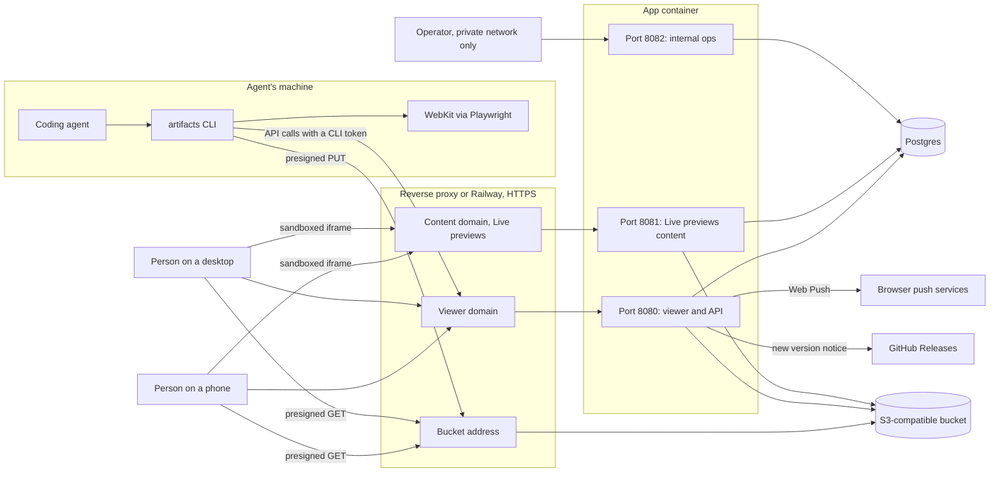
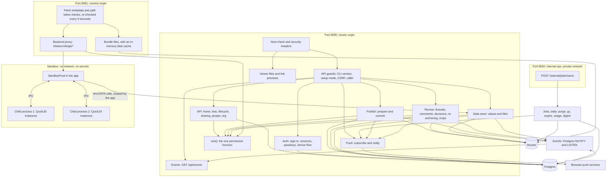
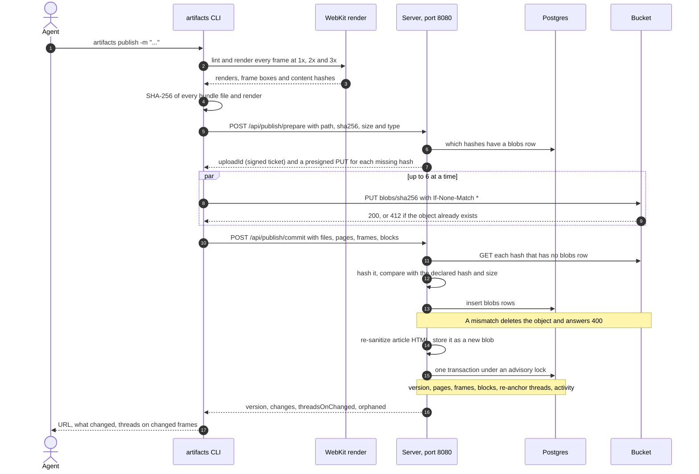
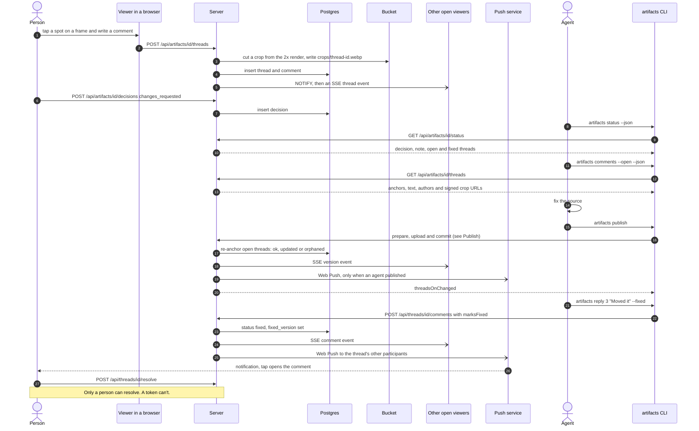
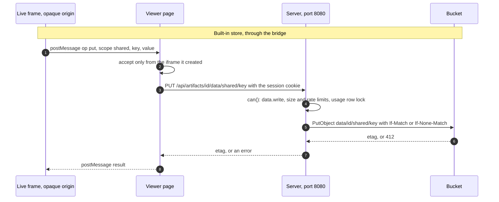
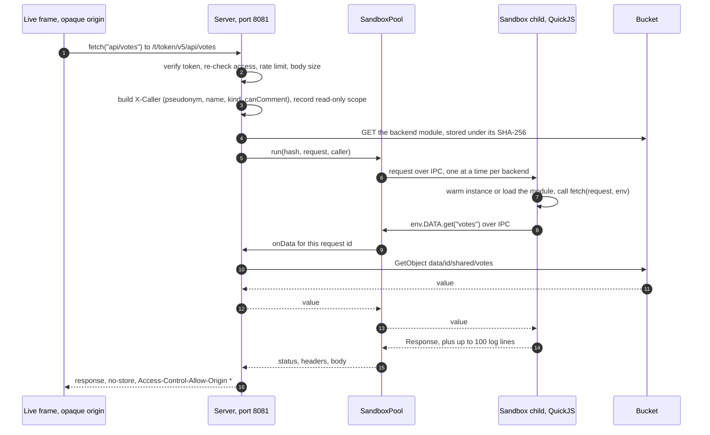
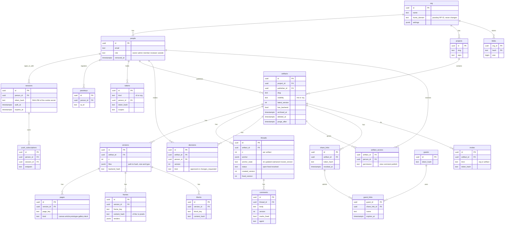
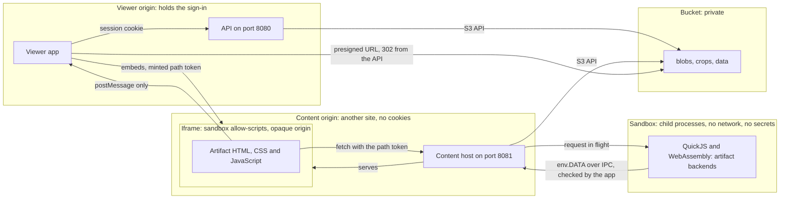
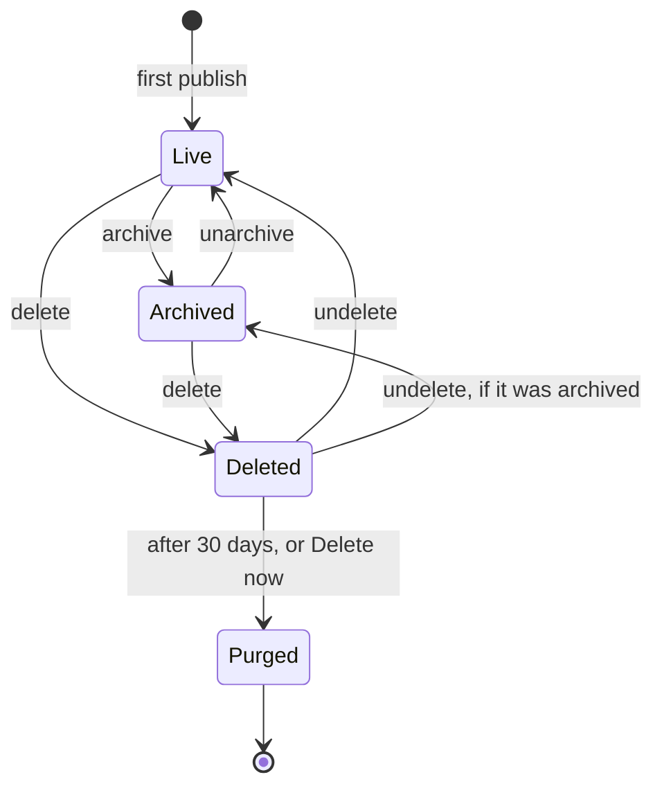

# Architecture

This is the document to read first. It shows how the pieces fit, with diagrams that GitHub renders. It doesn't repeat the contracts: for names and shapes, follow the links to [docs/implementation/](implementation/README.md), and for behaviour, to [SPEC.md](SPEC.md).

An agent publishes a bundle of pages. People review it and pin comments. The agent reads the comments, fixes the work, publishes again and replies. One server process, one Postgres database and one bucket make that work.

| Piece | What it is |
|---|---|
| CLI (`packages/cli`) | Lints, renders in WebKit, hashes, uploads and commits. Also the way to set up and run a server. |
| Server (`apps/server`) | One Bun and Hono process on three ports. It holds no state in memory that matters. |
| Viewer (`apps/viewer`) | A Preact app the server serves. Phone first, desktop too. |
| Postgres | People, sign-in, projects, artifacts, versions, review, activity. |
| Bucket | Every file, by SHA-256, plus each artifact's data folder. Private. |

## System context

- **Two sites.** The viewer domain and the content domain must be different registrable domains, so artifact code can't read anyone's sign-in. Railway's generated domains already are. See [SECURITY.md](../SECURITY.md).
- **Port 8082 has no domain.** Nothing public reaches it.
- **The bucket address** is the bucket's own endpoint on Railway. With Docker it is `S3_PUBLIC_ENDPOINT`, because presigned URLs go straight to the bucket.
- **Ports and hosts** are in [03](implementation/03-api.md#servers-and-ports). Variables are in [09](implementation/09-deploy.md#environment-variables).

## The server

- **One guard chain.** Every `/api` request is checked for the CLI's minimum version, setup mode and CSRF, and then resolved to one caller (person, CLI token, organization token, guest or content token). Routes call `can()` before they touch data. Details: [04](implementation/04-auth-and-permissions.md).
- **Realtime is a nudge.** An event says that something changed and holds no content. Each replica listens on one Postgres channel and fans the event out to its open streams. Browsers refetch through their own access.
- **The sandbox is the app's child.** A backend never holds a secret. It asks the app for `env.DATA`, and the app applies the scope it recorded for that request. See [08](implementation/08-micro-apps.md#backends-the-sandbox-appsserversrcsandbox).
- **Jobs run daily** on one replica at a time, behind an advisory lock. `POST /internal/jobs/:name` runs one by hand. See [05](implementation/05-publish-and-storage.md#clean-up).

## Publish

- **Republishing is cheap.** Only hashes without a `blobs` row are uploaded.
- **The bucket isn't trusted.** Anyone holding a presigned PUT chose what went there, so a hash counts as stored only once the server has hashed the object itself.
- **Rendering stays in the CLI.** The server never runs a browser.

Contract: [05](implementation/05-publish-and-storage.md) and [03](implementation/03-api.md#publishing-cli).

## The review loop

- **Nothing is pushed to the agent.** Agents run on people's machines. The skill makes every session start with `artifacts status`, which returns the decision and the open comments.
- **SSE reaches browsers only.** A stream closes after 5 minutes and the browser reconnects, which checks access again. Polling with ETags is the fallback.
- **Re-anchoring** compares each frame's content hash, and finds an article quote again even if its block moved. Rules: [05](implementation/05-publish-and-storage.md#re-anchoring).

## A micro app request

A live frame runs in an iframe with an opaque origin: no cookies, no storage, and no way to call the API itself. It has two ways out. The built-in store goes through the viewer. A backend is called through the content host.

- **The app owns the scope.** An `env.DATA` call carries only the request id. The app looks up the artifact and the read-only flag it recorded, and refuses calls for requests that aren't in flight. A backend can't widen what its caller may do.
- **Limits** (time, memory, queue, sizes) are in [08](implementation/08-micro-apps.md#backends-the-sandbox-appsserversrcsandbox).

## Data model

Every table also has `org_id`, except `org` itself. Columns are trimmed to the ones that explain the shape. The full list is in [02](implementation/02-data-model.md).

Left out of the diagram, and all small:

- Sign-in: `passwords`, `webauthn_challenges`, `reset_links`, `device_codes`
- Reading state: `views`, `guest_views`
- Records: `activity`, `tombstones` (the one line a purge leaves)
- Micro apps: `artifact_usage` (data store counters), `backend_logs`

Threads and comments have either a person or a guest as their author, never both. Bucket prefixes (`blobs/`, `crops/`, `data/`) are in [02](implementation/02-data-model.md#bucket-layout).

## Trust boundaries

| Boundary | What holds it |
|---|---|
| Viewer origin and content origin | Different registrable domains. Cookies are host-only. The viewer's CSP allows `frame-src` for the content origin and nothing else. |
| Content origin and the page | CSP `sandbox allow-scripts` on every response, so the origin is opaque even at the top level. `Sec-Fetch-Dest` must be `iframe` or a sub-resource type, never `document`. |
| Frame and viewer | The `postMessage` bridge. The viewer takes messages only from the iframe it made, and takes the artifact and version from its own record. |
| App and sandbox | An IPC channel. The child has no secrets, and the app checks every call against the request in flight. |
| App and bucket | The bucket is private. Browsers reach it by presigned GET (a day long, stable within a UTC day) and the CLI by presigned PUT (15 minutes). |

Details and assumptions are in [SECURITY.md](../SECURITY.md), [04](implementation/04-auth-and-permissions.md) and [03](implementation/03-api.md#content-host-live-previews).

## Lifecycle

Archiving and deleting are separate flags. An archived artifact can be deleted, and restoring it from Recently deleted returns it to archived. A version can be removed and purged the same way, except the latest or only one.

| State | What it means | Who can do it |
|---|---|---|
| Live | Normal. Reviewable, publishable. | |
| Archived | Hidden from lists, links keep working, read-only (no comments, versions or approvals). Data writes are refused. | Publisher or admin. Agents too. |
| Deleted | In Recently deleted for 30 days. Links and share links stop at once. The slug stays taken. | Publisher or admin. Agents too. |
| Purged | Rows, crops and the data folder are erased. One tombstone and one activity line remain. Blobs go in the next garbage collection if nothing else uses them. | A person with a recent sign-in, or the daily job after 30 days. Never a token. |

Rules: [SPEC.md §5.5](SPEC.md#55-archive-and-delete).

## Where to go next

| To learn | Read |
|---|---|
| What it does and why | [SPEC.md](SPEC.md) |
| Table and column names | [02 Data model](implementation/02-data-model.md) |
| Routes, ports, error codes | [03 HTTP API](implementation/03-api.md) |
| Who may do what | [04 Sign-in and permissions](implementation/04-auth-and-permissions.md) |
| The manifest, renders, re-anchoring | [05 Publishing and storage](implementation/05-publish-and-storage.md) |
| The viewer | [06 The viewer](implementation/06-viewer.md) |
| CLI commands | [07 The CLI and the skill](implementation/07-cli-and-skill.md) |
| Micro apps | [08 Micro apps](implementation/08-micro-apps.md) |
| Deploying and releases | [09 Deploying](implementation/09-deploy.md) |

## Agents: the library and the connector

Agents reach hosted work three ways, all ending in the same functions in `apps/server/src/library/` and the same `can()`: the CLI (`search`, `list`, `read`, `view`), the local `artifacts mcp`, and the hosted MCP at `/api/mcp`. The hosted one signs in through our own OAuth server (`apps/server/src/oauth/`). Rendering stays on the client: `artifacts pack` writes a publish to a folder, files go straight to the bucket, and the server commits by hash. [03](implementation/03-api.md#oauth-and-the-hosted-mcp) has the details.
