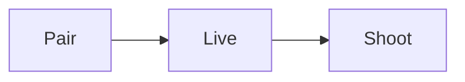

# Camera Buddy roadmap

A plan for a camera remote that helps people shoot, cull and learn.

## Phase 0

Pick the protocol and prove the live view works over Wi-Fi. {Verified}

> [!NOTE]
> The live view runs at 15 frames a second on the test body.

## Phase 1

Ship pairing, live view and shutter control.

| Step      | Owner | Status      |
| --------- | ----- | ----------- |
| Pairing   | Sam   | Done        |
| Live view | Jo    | In progress |
| Shutter   | Sam   | Not started |

::frame{ref="mocks/shoot/live-view"}

::chart{src="charts/battery.json"}

## Phase 2

Add culling and assistance. {Unverified}
