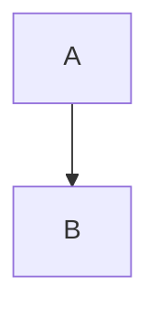

# Atoms

*The flow, from intake to answer.*

::chart{src="data/sales.json"}

::frame{ref="home/board/hero"}

Raw HTML block

A paragraph with an inline  image stays exact.

A sentence with a footnote.[^1]

[^1]: The footnote's text.

A [reference link][ref] uses a definition.

[ref]: https://example.com/ref

::unknown{x=1}

Text after the atoms, with **bold**.
